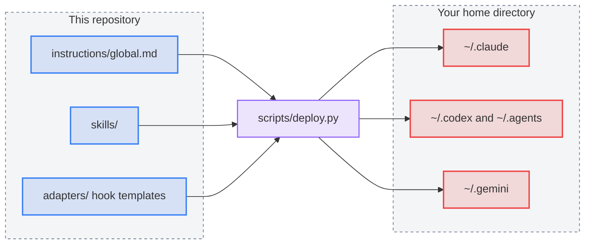

# Coherent Output

Coherent Output is one library of instructions, skills, and hooks that you write once and use in several AI coding agents. It currently supports Claude Code (CLI and desktop app), Codex, and Antigravity. The aim is that every agent communicates plainly, follows the same working method, and checks its own output, no matter which one you open.

Each agent keeps its configuration in a different place and in a different format. This repository holds the single source and an installer that connects it to each agent on a given machine. Edit once, and every agent sees the change.

## The whole picture

The library has three kinds of content:

- **Instructions** ([instructions/global.md](instructions/global.md)): a short baseline that sets how an agent communicates, plans, verifies, and decides when to ask.
- **Skills** ([skills/](docs/skills.md)): 16 task playbooks, such as writing commit messages, researching with sources, drafting Mermaid diagrams, and rewriting emails. An agent reads a skill only when the task needs it.
- **Hooks** ([adapters/](adapters/README.md)): checks that run after an agent edits a file. They format the file with Prettier and compile any Mermaid diagrams. They return errors to the agent.

The installer, [scripts/deploy.py](scripts/README.md), reads these sources and writes into each agent's home directory.

**Diagram: One source feeds every agent through the installer**



## Quick start

Requirements: Node.js 22.13.0 or later and Python 3, on macOS or Linux.

```bash
git clone https://github.com/kanad13/coherent-output.git
cd coherent-output
npm ci
./scripts/deploy.sh --dry-run   # preview every link and file
./scripts/deploy.sh             # install for all supported agents
./scripts/verify.sh             # confirm the result
```

Start a new chat in each agent afterward, because agents read instructions, skills, and hooks at session start. Add `--tool claude`, `--tool codex`, or `--tool antigravity` to install for one agent only.

To copy a few skills into one project without the global setup, use the [Skills CLI](https://github.com/vercel-labs/skills):

```bash
npx --yes skills@1.7.2 add kanad13/coherent-output --list
npx --yes skills@1.7.2 add kanad13/coherent-output \
  --skill commit-scribe --agent claude-code codex gemini-cli --yes
```

This route copies only the selected skill folders. It installs no instructions or hooks, and a copy does not follow later changes here.

## How one source reaches every agent

The installer uses three mechanisms, chosen by how each agent treats the target file.

| Mechanism    | Used for                                       | Why                                                                                                    |
| ------------ | ---------------------------------------------- | ------------------------------------------------------------------------------------------------------ |
| **Symlink**  | Skills, and Antigravity's instructions         | The agent reads the repository's files directly, so an edit is live at the next session with no deploy |
| **Generate** | Codex and Claude Code instructions, hook files | The content is composed from several sources and holds this machine's absolute paths                   |
| **Merge**    | Hook entries in Claude Code and Codex settings | The agent also writes these files, so the installer changes only its own entry                         |

Where the files land:

| Agent           | Instructions                      | Skills                    | Hooks                                                                      |
| --------------- | --------------------------------- | ------------------------- | -------------------------------------------------------------------------- |
| Claude Code     | `~/.claude/CLAUDE.md` (generated) | `~/.claude/skills`        | Safety gate and document check merged into `~/.claude/settings.json`       |
| Codex           | `~/.codex/AGENTS.md` (generated)  | `~/.agents/skills`        | `PostToolUse` entry merged into `~/.codex/hooks.json`                      |
| Antigravity IDE | `~/.gemini/AGENTS.md`             | `~/.gemini/config/skills` | Safety gate, formatter, and diagram check in `~/.gemini/config/hooks.json` |

Claude Code covers both the CLI and the Claude desktop app's Code tab, because they share `~/.claude`.

### Global and per-repository instructions

Every agent loads its global file first, then the `AGENTS.md` of the repository you are working in. The global file comes from [instructions/global.md](instructions/global.md). This repository's own [AGENTS.md](AGENTS.md) holds only the rules for working on this library, so the two never overlap.

### Several machines

Git carries the sources between machines. Generated files hold absolute paths, so they stay out of Git (`.generated/` is ignored) and each machine runs its own `deploy.sh`. The workflow on any machine is: pull, `npm ci`, deploy, verify, start new chats.

### Platforms

The installer needs only Python, POSIX symlinks, and home-relative paths. It is developed and tested on macOS. Linux uses the same code path, but this repository has not been run on Linux. Windows is not supported. Two tests that simulate a macOS GUI environment skip on other systems.

## What changes when you edit

| You edit                                                     | Then run              | Takes effect                                                                                    |
| ------------------------------------------------------------ | --------------------- | ----------------------------------------------------------------------------------------------- |
| A skill's contents                                           | Nothing               | Next chat, in every agent                                                                       |
| A skill's name, a new skill, or a reference to another skill | `./scripts/deploy.sh` | Next chat; validates the metadata and the [call graph](docs/skills.md#4-routing-and-call-graph) |
| `instructions/global.md`                                     | `./scripts/deploy.sh` | Next chat, after regeneration                                                                   |
| A hook template or adapter                                   | `./scripts/deploy.sh` | Next chat, after trust review                                                                   |

Always finish with `./scripts/verify.sh`. It reports any difference between the repository and the installed state. A change to what a skill produces also needs a trial: run a fresh agent with only that skill and a sample input, then inspect the result.

## What the hooks check

After an agent edits a file, [document-check.py](adapters/shared/document-check.py) formats it with the target project's Prettier configuration, or this repository's if the project has none. For Markdown, it also compiles each Mermaid diagram. On failure it returns the error to the agent so the agent can fix it.

Hooks run after the edit, so they cannot undo it. They do not see files changed by shell commands; `verify.sh` covers those. Antigravity and Claude Code also have a pre-command gate that asks for review before destructive Git, SQL, and `rm` forms. It is a pattern check, not a security boundary.

## Installer safety

- **Unknown files stop the install.** If a destination holds a file the installer does not own, nothing is written. Rerun with `--backup-conflicts` to move the original into `~/.local/state/coherent-output/backups/` with a restore manifest.
- **Merged settings keep your other settings.** In `settings.json` and `hooks.json`, the installer adds or updates only its own hook entry. Your other keys and hooks stay as they are. Before it rewrites a file, it saves a copy in the backup directory.
- **Broken settings are never touched.** If an existing settings file is not valid JSON, the installer stops before any write and names the file. Fix the file yourself, then rerun. The installer does not guess what you meant.

`./scripts/deploy.sh --check` reports drift without writing.

## Verification status

`./scripts/verify.sh` runs the installed-state check, the behavior tests, a Prettier check, and a Mermaid compile of every diagram in the repository. Two automatic gates run the same checks without you: a Git pre-commit hook (`.githooks/`, enabled by `deploy.sh`) runs the fast ones, and the [GitHub Actions workflow](.github/workflows/verify.yml) runs everything except the installed-state check on each push.

Native delivery is confirmed in live sessions for Codex and Claude Code: skills and instructions load, and the hook fires after an edit. Antigravity delivery is not yet observed. The [verification guide](scripts/README.md#3-verification-strategy) lists how each case is checked.

## Repository layout

| Path                                    | Contents                                                          |
| --------------------------------------- | ----------------------------------------------------------------- |
| [instructions/](instructions/global.md) | Template for the global instructions installed into every agent   |
| [AGENTS.md](AGENTS.md)                  | Rules for working on this repository                              |
| [skills/](docs/skills.md)               | Skill folders; [docs/skills.md](docs/skills.md) has the inventory |
| [docs/](docs/skills.md)                 | Skill authoring contract and maintenance steps                    |
| [adapters/](adapters/README.md)         | Per-agent link maps, hook templates, and the shared checker       |
| [scripts/](scripts/README.md)           | Installer, tests, and the verification runner                     |
| [rules/](rules/)                        | Optional scoped policies (none written yet)                       |

To support a new agent or add a hook, follow [adapters/README.md](adapters/README.md#4-adding-an-application-or-a-hook).

## License

[MIT](LICENSE)
